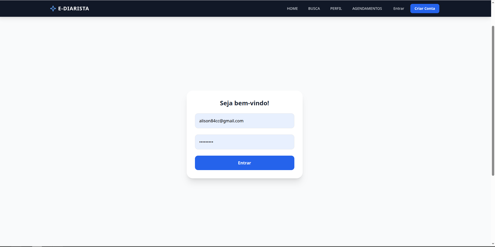
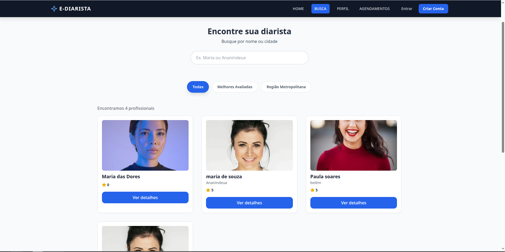
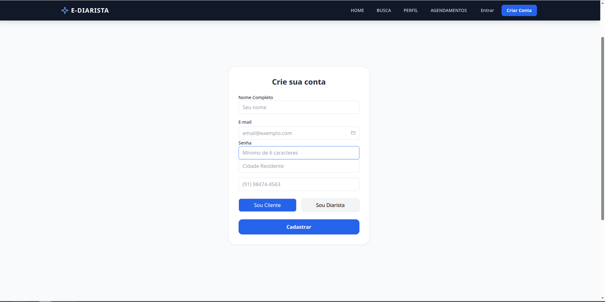

# 🧹 e-Diaristas — Plataforma Web de Serviços Domésticos

Uma aplicação web desenvolvida para conexão entre clientes e profissionais de limpeza doméstica, integrada com serviços de autenticação em nuvem.

[🚀 Clique aqui para acessar a aplicação em produção](https://e-diaristas-react.vercel.app/)

---

## 📌 Sobre O Projeto

O **e-Diaristas** facilita a busca e contratação de serviços de limpeza, destacando-se pela componentização moderna, responsividade e integração com Firebase.

### 🎯 Principais Funcionalidades
*   **Landing Page Responsiva:** Navegação fluida (*Mobile-First*).
*   **Autenticação com Firebase:** Gestão segura de sessão.
*   **Painel/Dashboard:** Área para agendamentos e perfil.
*   **Handoff Design-to-Code:** Estilização com Tailwind CSS baseada em protótipo.

---

## 🖥️ Telas do Projeto

<table align="center">
  <tr>
    <td align="center"><b>Landing Page</b><br></td>
    <td align="center"><b>Dashboard</b><br></td>
  </tr>
  <tr>
    <td align="center"><b>Tela de Login (Firebase)</b><br></td>
     <td align="center"><b>Dashboard</b><br></td>
  </tr>
</table>

---

## 🛠️ Tecnologias Utilizadas
*   **Front-end:** React.js, Tailwind CSS, Vite, Lucide React.
*   **Roteamento:** React Router DOM.
*   **BaaS:** Firebase.
*   **Deploy:** Vercel.

---

## 🚀 Como Executar o Projeto Localmente

```bash
git clone https://github.com/ALI84CC/e-diaristas-react
cd e-diaristas-react
npm install
npm run dev
```

---

## 🌐 Recursos Adicionais
*   [Protótipo no Figma](https://figma.com)##Reestruturação
*   [Deploy Ativo na Vercel](https://vercel.app)
