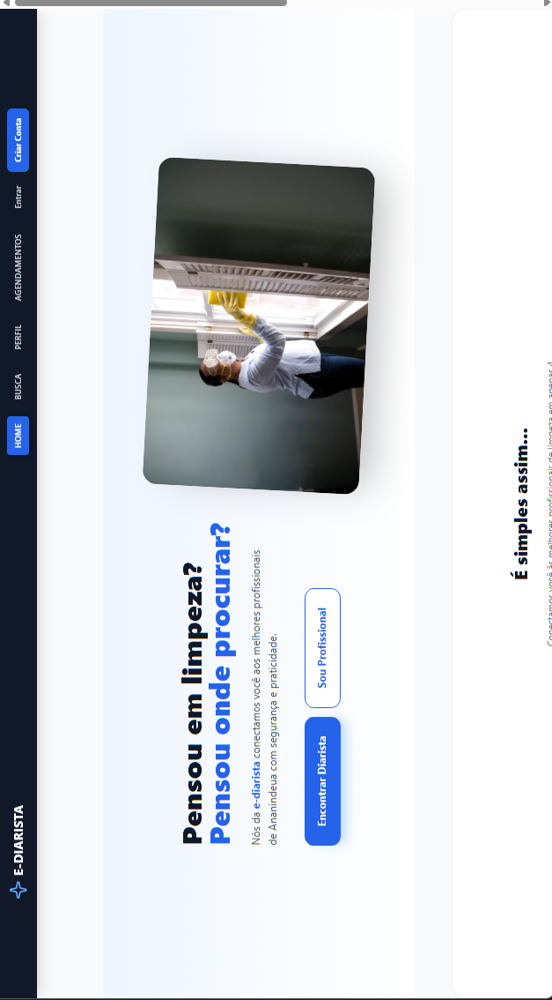

# 🧹 e-Diaristas — Plataforma de Serviços Domésticos

Aplicação web para conectar clientes com profissionais de limpeza doméstica.

**🚀 Ver funcionando:** https://e-diaristas-react.vercel.app/

### O que o projeto faz

- Landing Page responsiva
- Cadastro e login com Firebase
- Dashboard com lista de diaristas
- Agendamento de serviço e área de perfil

### Tela Principal do Projeto

### Tecnologias que usei

- React.js + Vite
- Tailwind CSS
- React Router DOM
- Firebase (Autenticação)
- Deploy na Vercel

### Como rodar na sua máquina

git clone https://github.com/ALI84CC/e-diaristas-react
cd e-diaristas-react
npm install
npm run dev

### Login para testar

Email: teste@teste.com.br
Senha: 123456

### O que eu aprendi nesse projeto

- Como fazer login de verdade com Firebase
- Como separar as telas com React Router
- Como pegar um protótipo do Figma e transformar em código com Tailwind
